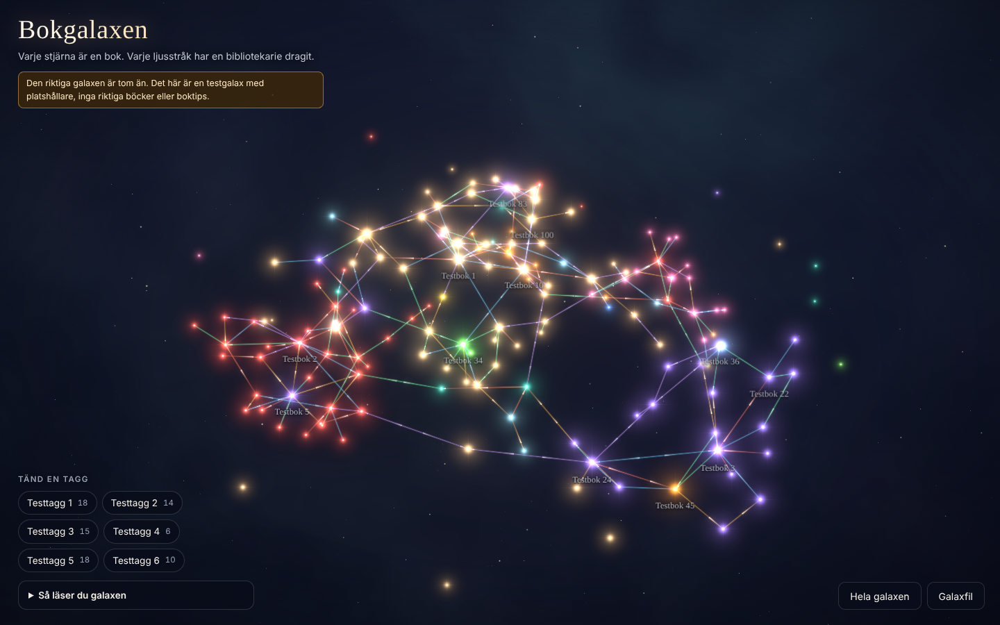

# Bokgalaxen

En visuell prototyp av en bibliotekariedriven boktipstjänst. Böcker är stjärnor i en 3D-rymd, och varje ljusstråk är en koppling som en bibliotekarie har gjort, med en kort motivering.

- `docs/PLAN.md`: hela projektplanen.
- `PROGRESS.md`: var projektet står just nu.
- `docs/VERCEL.md`: så publiceras sidan på Vercel, med inloggning för redaktörer.

## Köra sidan på din egen dator

1. Installera [Node.js](https://nodejs.org) om du inte har det.
2. Öppna en terminal i projektmappen och hämta det sidan behöver:

   ```bash
   npm install
   ```

3. Starta sidan:

   ```bash
   npm run dev
   ```

4. Öppna adressen som visas i terminalen, oftast `http://localhost:5173`.


